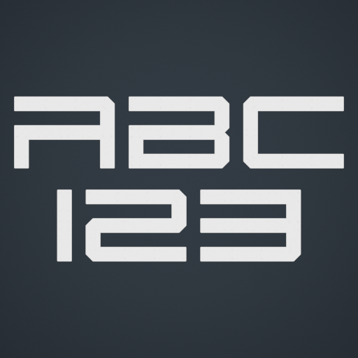
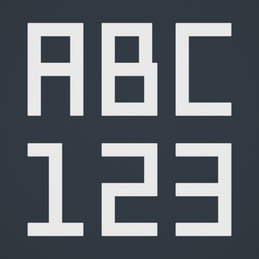
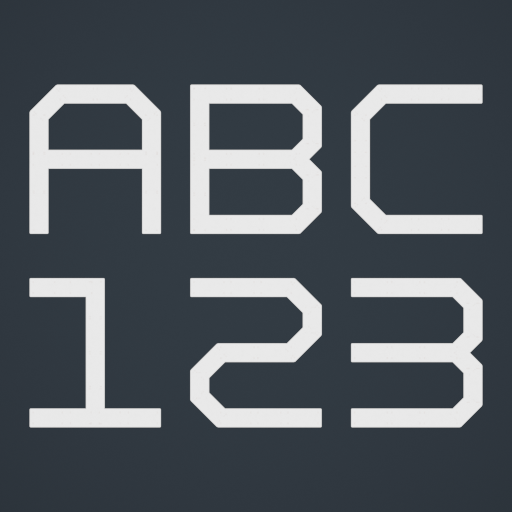
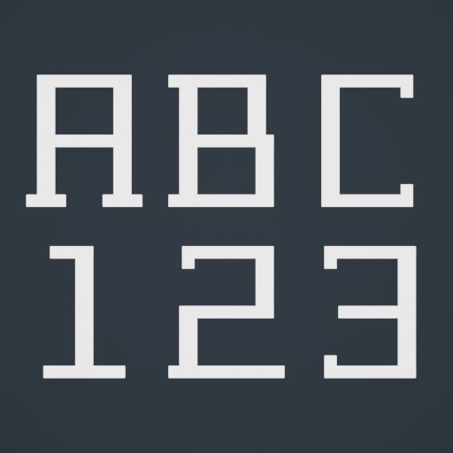
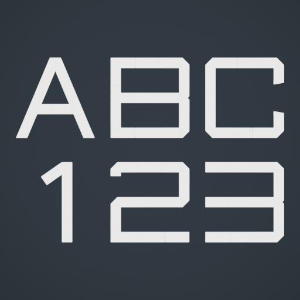

<a href="https://www.buymeacoffee.com/furiousfurby">
  
</a>

# NMScribe — No Man's Scribe for Blender Base Builder

Build editable No Man's Sky lettering from native Flat Panels or Storage Panel backs, with five
panel-lettering styles, visual previews, automatic style switching and right-click editing.

**NMScribe v2.2.8 highlights Generate and fixes Follow Curve on Bezier circles; Match colours is off by default.** Straight edges stay aligned; curves retain consistent facets. Solid backing, raised colour inlays, Blender curve placement and the compact SVG colour selector remain supported. It includes SVG
**Icon / Sticker mode (experimental)** alongside the five lettering styles. Switch modes
under the branding header, import a local SVG, and adjust accuracy and a hard
panel limit. The fitted silhouette preview and part count update before you
generate anything. Icons use native panels, stay editable in separate collections,
and export as native JSON. Solid SVG fills and strokes can retain their visible
colour regions, matched to the nearest native NMS primary palette colour.
Single-colour silhouette mode remains available. Textures, finishes and lighting
affect the appearance; this is approximate panel geometry.
[SVG instructions and limitations](USER_GUIDE.md#svg-icons-and-stickers).

Created by **FuriousFurby**, shared with the community through **Corvette Class
Builders (CCB)**. [Join CCB](https://discord.gg/arbW3DvM5y) and visit
**Traveller Toolkit** (channel access requires the appropriate server role).

An independent Blender add-on with its own **NMS Text** sidebar. It calls
No Man's Sky Base Builder's native-part functions; it does not modify that add-on.
**Charon Forge is optional:** use it for HD models/textures, or use Base Builder's
standard native models/materials without it. The previous combined add-on remains supported.

## New in 2.2.8

- **SVG colour matching:** opt in with Match colours, then customize each match in the Colours popout. Station palettes are optional.
- **Follow Curve:** select existing generated text/icon panels or their control together with one Blender curve, then click Follow Curve. Expand Curve Options for fit, reverse, facing, restore-flat, and Around curve angle.
- **Responsive previews:** animated progress, stage and elapsed time while previews generate.
- **Cleaner icon fitting:** aligned straight edges, more consistent curved outlines, seam repair, and overlapping backing/inlays where useful. Complex SVGs still need a realistic part budget.
- **Clearer controls:** large highlighted Generate buttons, compact options, and colour matching off by default.


## Download and install

Download the installable **NMS_Text_Generator_<version>.zip** from
[Releases](https://github.com/slipperystickers/nms-text-generator/releases/latest).
Do **not** install GitHub's automatically generated Source code ZIP.

1. Install and enable the compatible No Man's Sky Base Builder first.
2. In Blender, open **Edit > Preferences > Add-ons > menu > Install from Disk**.
3. Select the add-on ZIP without extracting it, then enable **NMScribe for Blender Base Builder**.
4. After an update, save your work and restart Blender.
5. Hover over the 3D Viewport, press **N**, and open the **NMS Text** tab.

Tested on **Blender 5.1.2 and 5.2.2 LTS / Windows**:

| Base Builder | Charon Forge | Validation |
| --- | --- | --- |
| Combined 18.0.9 | Not required | Native text/icons and curve placement on Blender 5.1.2 |
| Stock 6.5.2 | Disabled | Native text/icons and curve placement on Blender 5.2.2 |
| Stock 6.5.2 | Enabled | Native text/icons and curve placement on Blender 5.2.2 |

These version numbers belong to different release lines. The same sign settings,
native item IDs, placements and part counts work in all three; switching providers
does not rebuild saved signs automatically. Regenerate a sign to refresh its models.
Required native assets are `BUILDFLATPANEL` and, for Storage mode, `STORAGEPANEL`.
Other builds/operating systems are not yet verified. No game meshes or textures
are bundled in this text add-on, and it never substitutes invented geometry.

## Quick start

1. Use **Object Mode** and place the **3D Cursor** at the sign's baseline anchor.
2. Enter text, choose a style, set size/spacing and orientation, then click **GENERATE TEXT**. **Storage Panels (back)** is the default in both Text and Icon / Sticker modes; Flat Panels remains available.
3. Leave all panels of that sign selected and choose another style or panel type to regenerate automatically.
4. Later, select any one panel and right-click **Edit NMS Text**. Confirm with **OK**; Cancel changes nothing.
5. Use **Select Control** to move, rotate or uniformly scale the whole sign.
6. Save your `.blend` to keep the text editable. Use **Export Selected Text JSON** for native-part export.

**[Read the complete User Guide](USER_GUIDE.md)** — installation, every setting,
multiline text, mounting, colours, re-editing, examples, export and troubleshooting.
The launch package also includes **NMScribe_Instructions.html**: a complete,
searchable, printable offline instruction page with no login or internet required.
Existing files retain their saved panel choice; old signs without that setting
still use Flat Panels. A new default never rebuilds existing work.

## Five panel-lettering styles

| Boundary | Bulkhead | Orbit | Forge |
| :---: | :---: | :---: | :---: |
|  |  |  |  |
| Wide technical lettering | Squared utility lettering | Chamfered geometric lettering | Rectangular slab serifs |

### Vector (new in public release 1.6.0)



Orbitron-inspired ship lettering with custom flat-capped diagonals, a softer D,
triangular A, corrected 4 and upright 7. Standard 4.9-unit character cells and
0.64-unit strokes at the native five-unit height; I uses a compact 0.64-unit
advance with the normal letter gap, 1 is centered, and Q's tail
extends beyond its body. Uses 4–32 panels per character (626 for A-Z plus 0-9).
The optimized title `TYNDUSTRIAL ASTRONAUTICS` uses 367 panels, including the
corrected C with inward-facing terminals. All exposed faces remain parallel.
Small panels approximate pointed ends; this is not an exact outline trace.

The picker uses the familiar label **Font**, but these are predefined NMS part
placements, not installable TTF/OTF font files. All styles support A-Z, 0-9,
and these thirteen symbols: `- _ / \ ? ! | [ ] + = : .`. Type directly in the
sidebar text field. Use `<br>` for a new line (also `<br/>` or `<br />`).
Backslashes are literal. Older saved escape-based signs remain compatible.
Commas and other unlisted punctuation are not supported. Lowercase converts to
uppercase. No arbitrary font tracing is included. See [credits and provenance](NOTICE.md).

**Panel type** changes the native item, not the font design or part count.
Storage Panels expose their plain back face; Flat Panels expose their decorated
front face. Both use uniform scaling and closely matched footprints. There is
no in-game evidence yet that one loads faster or more reliably than the other.

## Editing and safety

- Each sign has its own collection, parent control and saved text settings.
- Auto-switch defaults **ON**, works on one fully selected sign, and supports undo.
- Partial/mixed selections do not auto-rebuild. Right-click editing works from one panel.
- Rebuilding preserves the control transform, but replaces manual edits to generated panels.
- Panels retain their native proportions. Do not stretch, mirror, shear or join them.
- Only the front silhouette is intended to show; bury the rear geometry in a backing surface.
- The generator's 3,000-part limit is a safety guard, not a statement of NMS upload limits.
- It never writes live game saves. A JSON round trip does not preserve editable text metadata.

## Development

Requires Python 3.10+ for the standalone layout tests and packaging script:

```sh
python -m unittest discover -s tests -v
python scripts/build_release.py
```

The installer ZIP, offline instruction page, launch notes and SHA-256 checksums
are created in `dist/`. Building the release requires only Python's standard
library and no network. SVG fitting tests additionally use NumPy (already bundled
with Blender).

For the native integration tests, use Blender with the compatible Base Builder
installed. This opens a separate factory-startup/background session:

```sh
blender --background --factory-startup --python tests/blender_smoke.py
blender --background --factory-startup --python tests/blender_panels.py
blender --background --factory-startup --python tests/zip_smoke.py
```

The tests enable the installed split dependencies by default. Set
`NMS_TEXT_TEST_STANDARD=1` to test Base Builder without Charon Forge. For the
previous combined add-on, set `NMS_TEXT_TEST_LEGACY` to that add-on's directory;
`NMS_TEXT_TEST_DEPS` optionally supplies its already-unpacked Python dependencies.
Use a separate process per configuration; tests do not save Blender preferences.

Use `-- --installed` to test the installed module instead of this checkout.
Blender may return exit code 0 even when a script fails: check for the final
`ALL_NATIVE_TESTS_PASSED`, `ALL_PANEL_SWITCH_TESTS_PASSED`, and
`CLEAN_ZIP_INSTALL_PASSED` messages respectively. Build the ZIP before running
`zip_smoke.py`. Never run these tests in a working scene.

## License and credits

Plugin code is **GPL-3.0-or-later**; see [LICENSE](LICENSE) and [NOTICE](NOTICE.md).
The GPL notice does not license Hello Games assets or claim rights in referenced
third-party typeface designs. No game meshes, textures, Base Builder source,
TTF/OTF files, or packed Blender files are distributed here.

Thanks to **DjMonkey** for No Man's Sky Base Builder. This is an unofficial
community project, not endorsed by Hello Games, Blender Foundation, or Base Builder's author.

Blender generation/export and editing workflows have been tested. In-game,
unmodded multiplayer, console, and upload-limit behavior are not certified.
